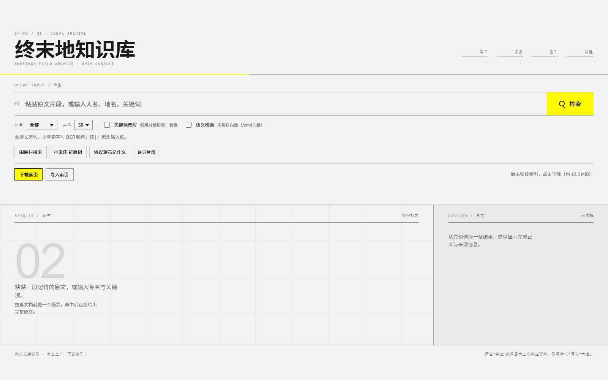
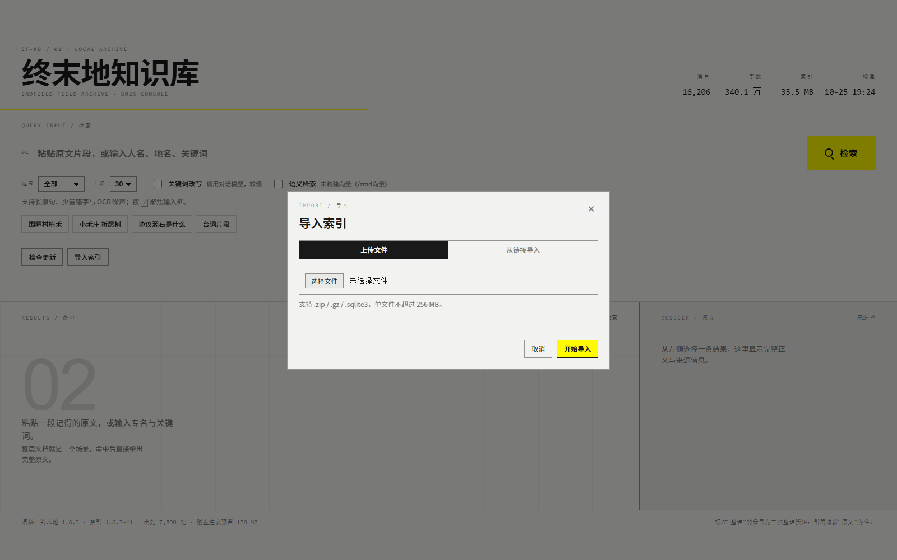
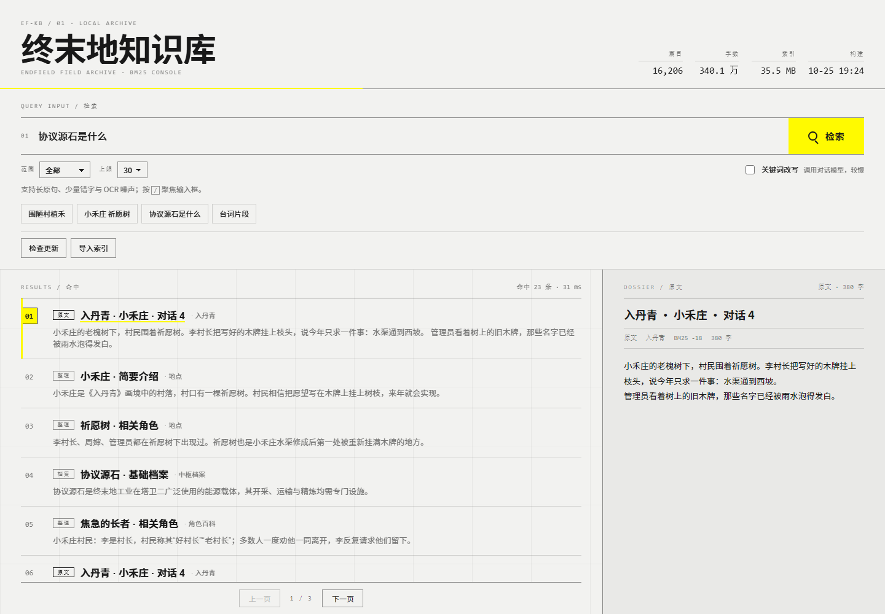

# 终末地知识库 · AstrBot 插件

本地 BM25 检索《明日方舟：终末地》的中文剧情、档案与整理资料。不依赖嵌入模型，不需要联网，索引与插件分离。

- 代码仓库：<https://github.com/lingyun14beta/astrbot_plugin_endfield_kb>
- 索引仓库：<https://github.com/lingyun14beta/astrbot-endfield-kb-index>

- 16,206 篇 / 340 万字，覆盖剧情原文、中枢档案、角色档案与语音、PRTS 整理资料
- 原文带说话人，整理资料的出处单独存为元数据
- 提供 LLM 工具、WebUI 控制台和 `zmd` 指令三种入口

## 特性

| 能力 | 说明 |
|---|---|
| 检索 | jieba 分词 + SQLite FTS5，BM25 排序；长原句、错字、OCR 噪声都能命中 |
| 检索单元 | 整篇文档（平均 200 余字，天然是一个场景），命中即可读全文 |
| 说话人 | 对话行入库时拼上 `speaker_raw`，旁白与黑屏文本没有说话人 |
| 出处 | `（dlg_e12m2_2）` 这类引用从正文剥离，按序存进 `refs`，详情面板可展开 |
| 索引管理 | 多版本共存、`current.json` 指针、完整性校验、原子替换 |
| 零外部依赖 | 不需要 embedding，不需要 API key |

## 安装

1. 把插件目录放到 `AstrBot/data/plugins/astrbot_plugin_endfield_kb/`
2. 安装依赖：`pip install jieba`（AstrBot 运行环境通常已自带）
3. 在 WebUI 插件页启用，或重启 AstrBot
4. 打开插件详情页的「终末地档案库」，点「下载索引」

## 磁盘占用

| 阶段 | 占用 |
|---|---|
| 索引 zip（下载） | 12.5 MiB |
| 单版本索引（解压后） | 35.5 MB |
| 更新峰值（旧库 + 新库 + zip） | 约 85 MB |
| 保留两版（默认） | 71 MB |

**建议预留 150 MB**：解压、校验、原子替换都需要临时空间，40 MB 只够放一份解压后的库。

## 准备索引

插件**不附带索引，也不会在启动时自动下载**。首次启用只做本地扫描，找不到索引就把按钮切成「下载索引」，等你手动点。

三种方式任选：

### A. 页面按钮（推荐）

打开「终末地档案库」，点 **下载索引**（约 12.5 MiB）。下载、校验、解压、替换全自动，完成后顶部数字立即刷新。



### B. 手动导入

控制台点 **导入索引**，弹窗里二选一：

- **上传文件**：选择本地 `.zip` / `.gz` / `.sqlite3`（不超过 256 MB）
- **从链接导入**：填 GitHub Release 或 ModelScope 的直链，由服务器下载；只接受公网地址



也可以自己下载后放进索引目录。下载地址：

```
https://github.com/lingyun14beta/astrbot-endfield-kb-index/releases/latest/download/endfield_kb-latest.sqlite3.zip
```

国内镜像：

```
https://www.modelscope.cn/api/v1/datasets/lingyun14/astrbot-endfield-kb-index/repo?Revision=master&FilePath=endfield_kb-latest.sqlite3.zip
```

不用解压，直接把 zip（或已经解压的 `.sqlite3`）放进：

```
AstrBot/data/plugin_data/astrbot_plugin_endfield_kb/index/
```

然后执行 `zmd 重载`。插件会自动解压、校验、切换；坏文件不会覆盖现有索引。

### C. 本地构建

需要本机有 PRTS 语料发布包：

```bash
python build_index.py                    # 自动找最新语料，构建并安装
python build_index.py --corpus <目录>     # 指定语料目录
python build_index.py --out <文件>        # 只构建，用于打包发布

# 写入本仓库自己的索引修订号（推荐），插件据此判断更新
python build_index.py --index-version 1.6.3-r1
```

约 30–60 秒，产出 35 MB 左右的 SQLite 文件。

### 索引目录结构

```
data/plugin_data/astrbot_plugin_endfield_kb/index/
├─ current.json                          # 指针：当前文件与版本
├─ endfield_kb-endfield-1.6.3-r1.sqlite3 # 当前索引
└─ endfield_kb-*.sqlite3.zip             # 待导入的压缩包（可选）
```

发现顺序：`current.json` → 目录内最新的库 → `.zip`/`.gz` 自动解压 → 旧路径迁移。

### 版本号

索引版本写成「语料版本 + 修订号」：

| 例子 | 含义 |
|---|---|
| `1.6.3-r1` | 语料还是 1.6.3，这是索引的第 1 次编译发布 |
| `1.6.3-r2` | 同一份语料，改了清洗、分词或结构，重新发布 |
| `1.7.0-r1` | 语料升到 1.7.0 后的第一次编译 |

修订号只表示「我们这边的优化」，不代表游戏或语料出了新版本。索引里写入 `meta.index_version`，控制台显示的、更新比较用的都是它；没有这个字段的旧索引回退到语料 release 名。

## 使用

### LLM 工具

`endfield_kb_search(query, top_k)`，由模型自行判断何时调用。返回带 `[原文]` / `[整理]` 标注的片段，整理类条目附「出处：…」。

### 指令

每个都是独立注册的指令，在 AstrBot 的指令列表里逐条可见：

| 指令 | 作用 |
|---|---|
| `/zmd <关键词>` | 检索，可直接贴原文片段 |
| `/zmd` | 不带关键词时显示索引状态 |
| `/zmd状态` | 篇数、语料版本、索引版本与体积 |
| `/zmd重载` | 重新扫描本地索引 |
| `/zmd更新` | 检查并安装最新索引（管理员） |
| `/zmd帮助` | 列出全部指令 |
| `/zmd订阅` | 当前会话加入版本推送（管理员） |
| `/zmd退订` | 移出版本推送（管理员） |
| `/zmd推送状态` | 订阅列表、已记录版本与最近检查时间（管理员） |
| `/zmd向量` | 构建语义向量索引（管理员） |
| `/zmd向量状态` | 向量索引与可用嵌入模型（管理员） |

旧的 `/zmd 重载`、`/zmd 帮助` 这类写法会提示改用的新指令，不再当作检索词。

### WebUI 控制台

插件详情页打开「终末地档案库」：检索、查看完整正文、展开出处、切换暗色主题，竖屏自动重排。

输入框下面两个筛选：

- **范围**：全部 / 剧情原文 / 中枢档案 / 整理资料 / 角色资料。切换即用当前查询重跑
- **上限**：10 / 20 / 30 / 50，默认 30；实际返回仍受相对分数阈值约束
- **关键词改写**：把口语描述压成检索词，调用对话模型，较慢
- **语义检索**：可选的向量召回，与配置里的开关同源；未构建向量时只走 BM25

结果按 **10 条一页** 分页。翻页条只在真的有多页时出现，排在列表最后一条下面，不悬浮、不遮挡内容。

版面是左右两块：左边检索与结果，右边当前选中的正文。**整页随内容向下滚动**，结果列表与正文都不做内部滚动条。

范围只收窄候选集合，不改变排序；命中条数还会被相对分数阈值再砍一次，所以实际返回常少于所选条数。

控制台里还有两个按钮：

- **检查更新**：对比本地与远端版本；发现新版本时按钮变成「更新到 x.y.z」，再点一次即下载安装
- **导入索引**：选择本地 `.zip` / `.gz` / `.sqlite3`，上传后校验并立即生效；导入期间进度条先扫描、完成后从左填满，随即关闭



## 配置

| 项 | 默认 | 说明 |
|---|---|---|
| `index_dir` | 空 | 索引目录；留空用 `data/plugin_data/astrbot_plugin_endfield_kb/index`，Docker 可指向挂载卷 |
| `custom_sources` | false | 自定义下载源开关；关闭时只用内置地址，开启后才显示下面两个列表 |
| `manifest_urls` | 空 | 更新清单地址列表，按顺序尝试；留空回退内置地址 |
| `index_urls` | 空 | 清单不可用时直接下载的 zip 地址列表；留空回退内置地址 |
| `rewrite_provider` | 空 | 控制台勾选「关键词改写」时用的模型，留空用当前会话的模型 |
| `top_k` | 5 | 默认返回条数 |
| `max_chars` | 1800 | 单次返回正文上限 |
| `score_ratio` | 45 | BM25 相对阈值，越小越严格 |
| `rewrite_timeout` | 12 | 关键词改写超时（秒） |
| `notify_group.enable` | true | 版本推送总开关 |
| `notify_group.interval` | 60 | 版本检查间隔（分钟，最小 5） |
| `notify_group.pre_download` | true | 是否推送预下载开放/关闭 |
| `notify_group.umos` | 空 | 推送目标会话，一行一个 UMO；/zmd订阅 会自动写入 |

版本推送单独成组，配置页里显示为「版本推送」卡片，排在最后。

控制台的「关键词改写」是硬开关：**勾上就一定调用模型改写，不勾就一次模型都不调用**（不再按查询长短自动跳过）。LLM 工具调用（`endfield_kb_search`）不做改写，模型传什么就查什么。

## 版本推送

插件会按固定间隔查一次鹰角启动器接口，比较正式版与预下载版本；有变化时，向订阅过的会话推送一条纯文本。**这条链路和索引更新完全独立**，推送失败不影响检索，索引更新也不会触发推送。

- 订阅目标是 AstrBot 的 `umo`，所以私聊、群聊、不同平台都能分开订
- 只有管理员能改订阅：`/zmd订阅`、`/zmd退订`、`/zmd推送状态`
- 订阅列表写在配置项 `notify_umos` 里，指令写入后会立即保存，也可以在 WebUI 里直接改
- 首次运行只记录当前版本，**不发送任何通知**，避免装完就刷屏
- 订阅只影响之后的变化：当前版本不会补发；某个版本发布时没人订阅，之后订阅也收不到那一条
- 推送全部失败时最多重试 3 轮（每轮间隔一次检查），仍失败则放弃并记录版本，日志会留 warning/error
- 默认 60 分钟检查一次；预下载可以在配置里关掉，只收正式版更新

推送文案：

```
【终末地】版本更新
1.6.3 → 1.6.4
完整包 58.1 GB｜增量 2.9 MB
客户端需更新后方可进入。
```

```
【终末地】预下载已开放
预下载版本：1.7.0
完整包 58.1 GB｜增量 3.1 GB
可提前下载，正式上线后直接更新。
```

```
【终末地】预下载已关闭
正式版本 1.7.0 即将上线。
```

## 语义检索（可选）

默认关闭。开启后每次检索会多一步：把查询编码成向量，与 BM25 的结果按 RRF 融合。**任何环节失败都会静默退回纯 BM25**——没配模型、没建向量、维度不符、调用超时，都只是少一层增强，不会让检索报错。

模型相关的代码单独放在 `semantic.py`，主插件只做接线。

- 需要先在「模型提供商」里配一个 embedding 类型的模型
- **控制台里也有开关**：和配置页的 `semantic_group.enable` 是同一个值，改哪边都生效（配置页刷新后同步显示）；嵌入模型在配置页填 id
- `/zmd向量` 构建向量（管理员），**默认增量**：内容没变的文档直接复用旧向量，只编码新增或有改动的；换模型会自动全量
- 语义召回遵守控制台的「范围」筛选；向量记录对应语料版本，索引更新后需重新构建
- `/zmd向量状态` 看向量索引、可用模型 id 和维度
- 向量存在索引目录的 `semantic/` 下：`semantic_vectors.npy`（float16）、`semantic_docs.json`（id + 内容指纹）、`semantic_meta.json`
- 1024 维模型约 33 MB；维度越高越大
- 换模型（含同维度）或维度变化时自动全量重建；从旧版本升上来第一次因为缺内容指纹，也会全量一次

| 配置 | 默认 | 说明 |
|---|---|---|
| `semantic_group.enable` | false | 是否启用（控制台开关同源） |
| `semantic_group.provider` | 空 | 嵌入模型 id，留空用第一个 |
| `semantic_group.weight` | 100 | 向量那一路的融合权重，100 为等权 |
| `semantic_group.candidates` | 30 | 向量召回条数 |

## 后端接口

| 路由 | 方法 | 用途 |
|---|---|---|
| `/astrbot_plugin_endfield_kb/stats` | GET | 篇数、字数、体积、构建时间、语料版本、分类计数 |
| `/astrbot_plugin_endfield_kb/search` | GET | `q` 查询词、`k` 条数（≤50）、`scope` 范围、`rewrite=1` 启用改写 |
| `/astrbot_plugin_endfield_kb/updates` | GET | 对比本地与远端版本 |
| `/astrbot_plugin_endfield_kb/update` | POST | 下载并安装最新索引 |
| `/astrbot_plugin_endfield_kb/upload` | POST | 接收手动上传的索引文件 |
| `/astrbot_plugin_endfield_kb/import_url` | POST | 按链接下载并导入索引 |
| `/astrbot_plugin_endfield_kb/semantic` | GET | 语义开关与向量索引状态 |
| `/astrbot_plugin_endfield_kb/semantic` | POST | 切换语义开关 |

## 设计取舍

- **整篇文档作为检索单元**：切块会打散场景，整篇更适合“命中即阅读”。
- **稀有词约束**：查询里 IDF 最高的一批词必须真的出现，否则“我/你/和”这类高频词会带进无关文档。
- **相对分数过滤**：强命中只回 1–2 条，弱命中才铺开候选。
- **原文优先**：整理资料标注 `[整理]`，只能当线索，引用以 `[原文]` 为准。
- **schema 版本**：索引写入 `schema_version`，插件不匹配时拒绝加载，避免半旧半新。

## 代码结构

```
main.py              插件类、指令、Web 接口注册（只做接线）
core/
  updater.py         索引安装、清单比对、下载与校验
  retrieval.py       关键词改写、BM25 + 语义融合、格式化
  pusher.py          版本推送的订阅、定时检查、发送
  webapi.py          控制台后端接口
  versioning.py      版本号、下载源、旧配置修复
endfield_kb.py       索引结构、清洗、FTS5 检索
index_store.py       索引文件校验、安装与目录管理
index_fetch.py       清单与下载的 HTTP 封装
notify.py            版本查询与推送文案
semantic.py          嵌入模型、向量存储、RRF 融合
```

## 已知限制

- 只覆盖中文；多语言语料未接入
- 纯 BM25，完全口语化的复述会退化，长描述建议开启关键词改写
- 语料停在终末地 1.6.3，最新主线到《入丹青》
- 不含音频、美术、BGM；语料里只有台词的语音资源 id

## 许可

- **代码**：AGPL-3.0-or-later，见 [LICENSE](LICENSE)
- **索引数据**：权利保留，不属于代码，不适用 AGPL；仅授予下载与本地检索使用，
  条款见数据仓库的 [LICENSE-INDEX.txt](https://github.com/lingyun14beta/astrbot-endfield-kb-index/blob/main/LICENSE-INDEX.txt)
- **游戏内容**：名称、文本及相关内容的权利归上海鹰角开拓者网络科技有限公司及相关权利人
- **整理内容**：权利归 PRTS.chat
- **未纳入**：PRTS Wiki《泰拉年表》（CC BY-NC-SA 4.0）与《明日方舟》语料

数据来源：PRTS.chat 终末地资料集（release 1.6.3）
<https://modelscope.cn/datasets/HTiantian/prts-agent-corpus-endfield>

本项目为非官方社区项目，与游戏开发商、发行商无隶属或背书关系。
